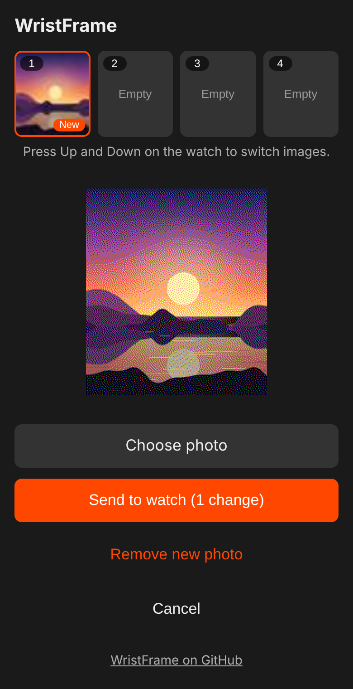

# WristFrame

A Pebble watchapp that shows a photo full screen, and nothing else. It holds up
to 4 photos; press Up and Down on the watch to switch between them.

Supported watches: **Pebble Time 2** (`emery`, 200×228) and **Pebble Round 2**
(`gabbro`, 260×260 round).

<p align="center">
  
  &nbsp;&nbsp;
  
  &nbsp;&nbsp;
  
</p>

## Usage

1. Install the `.pbw` (from the latest [GitHub Actions run](../../actions) or
   [release](../../releases)) with the Pebble app.
2. Open the app's settings in the Pebble app. Tap a slot and choose a photo,
   or use **Clear slot N** to empty it; repeat for as many slots as you like.
   Then tap **Send to watch** to send all the changes at once. The watch shows
   each photo as it arrives, with a progress bar (a ring on the Round 2) and
   a count such as "2/3". Pressing Up or Down while photos arrive shows
   another photo; the transfer carries on in the background.
3. Photos are stored on the watch, so they are available even when the phone
   is not connected. Press **Up** and **Down** to switch between them. The app
   reopens on the last photo shown.

## Privacy

Your photos never leave your phone. The settings page converts them on the
phone itself, and the result goes straight to the watch. Nothing is uploaded,
and there are no analytics or accounts. The only download is the HEIF decoder
described below, fetched from jsDelivr when you choose a HEIF photo.

## How it works

All image processing happens on the phone, in the settings page
([`config/index.html`](config/index.html)):

- **Decode:** JPEG, PNG and WebP decode natively. HEIF photos (the iPhone
  camera's default) are decoded with
  [libheif-js](https://github.com/catdad-experiments/libheif-js), which the
  page downloads from jsDelivr only when a HEIF photo is chosen.
- **Crop and resize:** the photo is scaled to cover the whole screen and the
  overflow is cropped evenly from both sides, so the screen is always filled.
- **Dither:** Floyd–Steinberg dithering to the watch's 64-colour palette.
- **Pack:** 6 bits per pixel. On the round watch, pixels outside the visible
  circle are left out (about 21% less data).

The packed image is about 34 KB on the Time 2 and 40 KB on the Round 2. The
settings page returns it to the app as URL-safe base64, together with a small
thumbnail for the slot tiles. The phone-side JavaScript
([`src/pkjs/index.js`](src/pkjs/index.js)) queues each change and sends it to
the watch in 2 KB AppMessage chunks. If a transfer is interrupted, it is
retried when the watch reconnects or the next time the app opens.

The watch ([`src/c/main.c`](src/c/main.c)) decodes chunks as they arrive. It
saves them to persistent storage in 256-byte records, plus a header with a
checksum that is written only once the whole image has arrived. Each slot has
its own range of storage keys. On launch it reads back the last photo shown.

The slot count is capped at 4 because persistent storage slows down as it
fills with records, including the dead records left behind when a photo is
replaced ([PebbleOS issue #2106](https://github.com/coredevices/PebbleOS/issues/2106)).
If the app becomes slow to open after many photo changes, reinstalling it
clears the stored data. This needs firmware with the 1 MB per-app
persistent storage limit (PebbleOS v4.9.171 or later). On older firmware the
image is shown but not remembered.

## Settings page hosting

The settings page is served from GitHub Pages at
`https://lanrat.github.io/WristFrame/`. The workflow deploys `config/` on
every push to the default branch. Enable it once under **Settings → Pages →
Source: GitHub Actions**. The `github-pages` environment only accepts deploys
from the branches listed under **Settings → Environments → github-pages**, so
update that list if the default branch changes.

## Releasing

1. Add a `## <version>` section to [`CHANGELOG.md`](CHANGELOG.md) describing
   the changes.
2. Bump `version` in `package.json`. Pebble apps can't have a patch version,
   so bump MAJOR or MINOR and keep the last number 0 (1.3.0, not 1.2.1).
3. Push to `main`.

The workflow checks both on every push, so a version without a changelog
entry fails the build before it can be released. When a new version reaches
`main`, the workflow builds the `.pbw`, creates the `v<version>` tag and a
GitHub release with that changelog section as its notes, attaches
`WristFrame-v<version>.pbw`, and uploads it to the app stores. Pushes that
keep the same version release nothing.

### App stores

The release job uploads each new version to the
[Pebble app store](https://apps.repebble.com) and the
[Rebble app store](https://apps.rebble.io). Each upload is skipped until that
store is set up, so releases work without them. The CI only updates existing
listings; create each listing once by hand.

Everything a listing needs is in [`store/`](store): the description, icons
(48, 80 and 144 px), a 720×320 banner, and three screenshots per watch. To
remake them:

```sh
node scripts/store-screenshots.js   # photos in store/photos/ -> store/screenshots/
python3 scripts/store-art.py        # icons and banner
```

The screenshot script runs the settings page in a headless browser, so it
needs Playwright (`npm install --no-save playwright && npx playwright install chromium`).
The art script needs Pillow.

**Pebble app store**

1. Run `pebble login` and `pebble build`, then create the listing:

   ```sh
   pebble publish --pbw build/WristFrame.pbw --non-interactive --is-published \
     --description "$(cat store/description.md)" \
     --source https://github.com/lanrat/WristFrame \
     --icon-small store/icon-80.png --icon-large store/icon-144.png \
     --screenshots store/screenshots/*.png \
     --release-notes "$(scripts/release-notes.sh --plain)"
   ```

   It picks a default category; change it, and add the banner, on the
   [dashboard](https://appstore-api.repebble.com/dashboard).
2. Add your login's refresh token as the repository secret
   `PEBBLE_FIREBASE_REFRESH_TOKEN`:

   ```sh
   jq -r .refresh_token ~/.pebble-sdk/oauth_firebase/firebase_oauth_storage.json
   ```

   On macOS the file is in `~/Library/Application Support/Pebble SDK/`, and
   on newer Linux installs in `~/.local/share/pebble-sdk/`.

**Rebble app store**

1. Create the app on the [Rebble developer portal](https://dev-portal.rebble.io/)
   with the `.pbw` from the latest GitHub release and the files in `store/`.
2. Add the app's ID, from its URL on the portal or store, as the repository
   variable `REBBLE_APP_ID`.
3. Add your portal access token as the repository secret
   `REBBLE_ACCESS_TOKEN`. The portal doesn't show it: copy the bearer token
   from the `Authorization` header of the portal's requests in your
   browser's developer tools.

Both stores reject a version that isn't newer than the one they have. If an
upload fails, fix the cause, then run the workflow on `main` from the Actions
tab and choose that store under **republish**. It uploads the current version
again without making a new release.

## Building

```sh
uv tool install pebble-tool
pebble sdk install latest
pebble build
```

The `.pbw` is written to `build/`. To try it in the emulator:

```sh
pebble install --emulator emery
pebble emu-app-config --emulator emery --file config/index.html
```

When you use `--file`, the page gets no screen size from the app and defaults
to the Time 2's 200×228. For the Round 2, add
`&width=260&height=260&round=1` to the URL the browser opens.

## License

[MIT](LICENSE)
